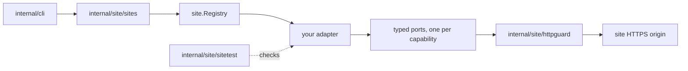

# Adding a site

[Documentation index](README.md) · [Project README](../README.md)

This guide is for contributors adding a built-in site adapter. ptctl ships two
sites today. TJUPT ([TJUPT_ADAPTER.md](TJUPT_ADAPTER.md)) is the reference for
cookie-authenticated HTML sites, and M-Team ([MTEAM_ADAPTER.md](MTEAM_ADAPTER.md))
is the reference for JSON APIs authenticated with an API key. The extension
points below exist and are enforced by tests; the
[gap list](#gaps-for-api-token-sites) at the end lists what API-token sites
still lack.

Read the invariants in [AGENTS.md](../AGENTS.md#invariants) first. They apply
to every adapter, and the conformance suite checks several of them.

## Before you start

- Check that the site's rules allow automated access of the kind you are
  adding. ptctl will not accept ratio cheating, fake upload, challenge bypass,
  or login automation.
- Choose the smallest useful set of capabilities. An adapter that declares only
  `auth.check` is a valid first contribution.
- Never commit a real cookie, token, passkey, private `.torrent`, or captured
  page or API response. Write synthetic fixtures from the documented shape of
  the site, using obviously fake values that contain `CANARY`.

## How a site plugs in

`internal/site/sites` is the only place the CLI learns which sites exist. For
each command, the CLI looks up the adapter by site ID, checks that the
descriptor declares the capability and the auth method, asserts the typed port,
and only then reads the credential, from stdin when a flag names it or else
from the file `site login` saved (`internal/cli/saved_credentials.go`). A new
site gets both sources and `site login --cookie-stdin|--api-key-stdin` without
CLI changes. Adapters never see filesystem handles, stores, or downloader
state.

## Step by step

1. **Create a package** at `internal/site/<id>/`. Export the persisted identity
   as constants, as `internal/site/tjupt/adapter.go` does with `SiteID` and
   `Origin`, and provide a constructor.
2. **Publish a descriptor** from `Descriptor()` that satisfies the
   [descriptor rules](#descriptor-rules).
3. **Implement one typed port per declared capability.** See
   [capabilities and ports](#capabilities-and-ports) for the contract of each
   kind of port.
4. **Register the adapter** by adding its constructor to `All()` in
   `internal/site/sites/sites.go`. Registration panics on a nil adapter, an
   empty ID, or a duplicate ID.
5. **Add conformance samples** for the new site ID to `samples()` in
   `internal/site/sites/sites_test.go`. `TestBuiltinAdaptersConform` fails
   until they exist, then runs `sitetest.TestAdapter` against the adapter.
6. **Test the adapter's own behavior** in its package: parsers against
   synthetic fixtures, page or response recognition including login,
   challenge, maintenance, and unknown responses, stop-reason ordering, and an
   `identity_test.go` that pins every persisted identifier. Inject a fake
   transport the way the TJUPT tests replace `newClient`; nothing may contact
   the real site.
7. **Document it**: add a `docs/<SITE>_ADAPTER.md` modeled on
   [TJUPT_ADAPTER.md](TJUPT_ADAPTER.md), and update
   [FEATURES.md](FEATURES.md) and the [site guide](guide/sites.md).
8. **Run the checks** listed in [AGENTS.md](../AGENTS.md#checks).

## Descriptor rules

`site.ValidateDescriptor` in `internal/site/descriptor.go` enforces these, and
the conformance suite calls it.

| Field | Rule |
|---|---|
| `ID` | Matches `^[a-z][a-z0-9_-]{0,63}$`, which fits every place a site ID is parsed or persisted. It is stored in refs, receipts, route IDs, and sealed records, so it never changes. |
| `Name` | Non-empty display name; non-ASCII is fine. |
| `BaseURL` | An HTTPS origin with at most a single trailing `/`: no user info, query, fragment, or other path. Every origin-pinned port's config must use exactly this origin. |
| `Stability` | Non-empty. New adapters start as `experimental`. |
| `AuthMethods` | At least one, each known, no duplicates. Only `cookie_header` exists today. |
| `Capabilities` | Each known, no duplicates, each backed by its typed port. |

`Descriptor()` must return the same value on every call and must not share its
slices with callers; the suite mutates the returned slices to check this.

## Capabilities and ports

`capabilityPorts` in `internal/site/descriptor.go` is the single mapping from a
capability to its port. Adding a new capability means adding a domain
constant, a port interface, and one entry there.

| Capability | Port | Kind | Used by |
|---|---|---|---|
| `auth.check` | `AuthChecker` | direct | `site status` |
| `account.read` | `AccountReader` | direct | `site account` |
| `torrent.search` | `TorrentSearcher` | direct | `site search` |
| `bonus.catalog.read` | `BonusCatalogReader` | direct | `site bonus-catalog` |
| `torrent.detail` | `TorrentDetailReader` | config and session | `site detail`, `reconcile report --site-ref` |
| `torrent.metafile.read_effectful` | `MetafileFetcher` | config and session | `site metafile fetch` |
| `bonus.offer.review` | `BonusReviewReader` | config and session | `site bonus review` |
| `bonus.exchange.submit_effectful` | `BonusExchangeWriter` | config and session | `site bonus exchange prepare`, `submit` |
| `auth.login_effectful` | `SessionLoginer` | login | `site login` |

### Direct ports

A direct port makes its request when it is called. It must:

- return an error wrapping `context.Canceled` before any request when the
  context is already done;
- reject a credential whose auth method the descriptor does not declare;
- send at most one bounded request through `httpguard`, with no retry;
- fail closed: a login page is unauthenticated, and a maintenance, challenge,
  or unrecognized response is an error, never an empty result.

A `TorrentSearcher` may also implement `OptionTorrentSearcher` to take
`site.SearchOptions`: a page, a site-defined mode, category IDs, and a
free-only filter, behind `site search --page`, `--mode`, `--category`, and
`--free`. `ValidateSearchOptions` must refuse anything the site cannot honor;
the CLI calls it before the credential is read and turns its error into a
usage error. A site without the port refuses those flags.

The CLI replaces every error from a direct port with a fixed
`site <command> failed` message, keeping only typed cancellation and deadline
causes, so adapter error text never reaches the user.

### Config and session ports

The detail, metafile, bonus-review, and bonus-exchange ports separate pure
preflight from the network:

- **Validation** (`ValidateTorrentDetailRef`, `ValidateMetafileRef`,
  `ValidateBonusReviewSelector`, `ValidateBonusExchangeSelector`) is pure. It
  reads no credential and contacts nothing. It must reject a foreign or
  non-canonical site ID and any remote ID or selector that is empty, padded
  with whitespace, or otherwise non-canonical.
- **Config** (`TorrentDetailConfig`, `MetafileFetchConfig`,
  `BonusReviewConfig`, `BonusExchangeConfig`) is credential-free and pins the
  origin and route IDs. The origin must equal the descriptor's origin. If the
  capability is not declared, the config call, validation, and session opening
  must all fail.
- **Opening a session** builds process-local state only. It must reject a
  canceled context and an undeclared auth method without sending anything.
- **Reading** sends at most one request; `MaxRequests` is fixed at one in the
  detail, metafile, and bonus-review limits. The one exception is a linked
  metafile route, declared with `site.NewLinkedMetafileFetchConfig`: before its
  one metafile `GET` it may make up to `MaxLinkRequests` (at most two) requests
  for a site-issued link, counted in `LinkRequestsAttempted`, and must treat
  that link as a secret (`httpguard.SecretLink`). Each receipt echoes the pinned
  origin and route ID. An invalid input, a done context, or a closed session
  must fail with zero requests. Their stop reasons are `invalid_reference` or
  `invalid_selector`, `context_done` (wrapping `context.Canceled`), and
  `session_closed`; a closed bonus-exchange session only has to return an
  error.

`BonusExchangeWriter` is stricter still: the session's first request must be
the bounded `ReadFreshBonusReview`, and the review authority it returns can be
consumed by at most one submission. Read the
[bonus exchange design](ARCHITECTURE.md#durable-at-most-once-bonus-exchange)
before implementing it.

If the site confirms each exchange with the account password, also implement
`PasswordConfirmedBonusExchangeWriter` and make the cookie-only
`OpenBonusExchangeSession` fail. The CLI then requires the
`site_cookie`/`site_password` bundle, and `sitetest` checks that the
cookie-only open is refused. Keep the `AccountPassword` value out of every
error, receipt, and formatted struct; TJUPT is the reference.

### Login port

`SessionLoginer` signs in and returns a new session `Credential`. Declare
`auth.login_effectful` only when the site's login form is understood well
enough to recognize every refusal page. `LoginConfig` lists the session
lengths the site offers and its default; the CLI rejects any other length
before reading stdin. `Login` must:

- return an error wrapping `context.Canceled` with zero requests when the
  context is already done (`sitetest` checks this);
- send one login request with no retry, and accept a session only after one
  verifying read with it names the same account;
- report recognized outcomes with a `*site.LoginError` and one of the
  `site.Login*` stop reasons, including the site's remaining-attempts count
  when its page states one;
- clear any response body that may echo the password, and keep
  `LoginCredentials` and the issued cookie out of every error and formatted
  value. TJUPT is the reference.

## Stop reasons

Receipts carry a stop reason, and the CLI publishes only values it already
knows. Any other value collapses into a generic code:

| Port | CLI allowlist (`internal/cli`) | Fallback |
|---|---|---|
| Torrent detail | `safeTorrentDetailStopReason` in `site_detail.go` | `site.detail_failed` |
| Bonus review | `safeBonusReviewStopReason` in `site_bonus.go` | `site.bonus_review_failed` |
| Metafile fetch | `publicMetafileStopReason` in `site_metafile.go` | `site.fetch_failed` |
| Bonus exchange submit | `safeBonusExchangeSubmitStop` in `site_bonus_exchange.go` | `site.exchange_failed` |
| Login | `knownLoginStopReason` in `site_login.go` | `site login failed` |

Reuse an existing stop reason whenever one fits. A new one is a public-contract
change: add it to the allowlist and to the CLI tests in the same commit.

## Public failure causes

Ordinary reads (`status`, `account`, `search`, `bonus-catalog`) fold every
adapter error into `site CMD failed`, so an adapter's own error text never
reaches the user. An adapter may wrap one of the sentinels in
`internal/site/errors.go` to let the CLI name a fixed, secret-free cause:

| Sentinel | Use when |
|---|---|
| `site.ErrCredentialMalformed` | The credential cannot be the format the site uses, checked before any request. |
| `site.ErrCredentialRejected` | The site positively rejected the credential. |
| `site.ErrRateLimited` | The site said to slow down. Never retry. |
| `site.ErrAddressBlocked` | `httpguard.ErrBlockedAddress`: DNS returned only private or reserved addresses, as with fake-IP proxies. |

Wrapping a sentinel changes that adapter's public error text, so add it
deliberately and pin it in tests. TJUPT's reads wrap none of them; its login
wraps `site.ErrAddressBlocked`, which `site login` names the same way.

## Persisted identity

Site IDs, origins, and route IDs are written into sealed site bindings,
bonus-exchange journals, and private-store records, and are verified when those
records are loaded. Changing one strands every existing record.

- Route IDs use only `[a-z0-9._-]`, are at most 128 bytes, start with
  `<site-id>.`, and end in a version such as `.v1`. The conformance suite
  checks the prefix.
- A new request shape gets a new `.vN` route ID; an existing route ID is never
  reused for different behavior.
- Pin every identifier in an `identity_test.go`, as
  `internal/site/tjupt/identity_test.go` does.

## What not to copy from TJUPT

- **The custom base URL.** `tjupt.New` accepts any base URL and then withdraws
  every origin-pinned capability unless the URL is exactly `DefaultBaseURL`.
  That keeps persisted route IDs from being retargeted, but it doubles the
  surface to test. A new adapter should bind to its production origin and
  inject a fake transport in tests instead.
- **Site-specific heuristics.** TJUPT's login, logout, and page recognition
  rules, its decimal size units, and its `mybonus.php` flow are facts about
  TJUPT, not about NexusPHP in general. Re-derive them for each site.
- **Ordering quirks.** TJUPT's sessions check their failure conditions in
  slightly different orders, and those orders are pinned by tests. Match the
  contract above, not one session's incidental ordering.

## Shared code waits for a second site

Do not extract a shared NexusPHP, Unit3D, Gazelle, or general "site kit"
package before a second adapter exists. With one implementation there is no
evidence of which behavior is shared and which is TJUPT-specific, and moving
TJUPT code would put its byte-exact tests at risk. When a second adapter lands,
extract only what both demonstrably share, keep TJUPT's output byte-identical,
and do it in a separate behavior-preserving commit.

## Site families

| Family | Fit today | Main work |
|---|---|---|
| NexusPHP forks, including TJUPT | Cookie sessions match `cookie_header`, and HTML responses match the existing ports. | Page recognition and parsers for that fork, with synthetic fixtures. Forks differ, so do not assume TJUPT's pages. |
| Unit3D | Cookie-session web pages fit. | Using its token-authenticated API instead runs into the gaps below. |
| Gazelle-based trackers | Cookie sessions fit; their JSON responses need a JSON parser rather than HTML recognition. | Where an API key replaces the session cookie, the gaps below apply. |
| M-Team | Status, account, search, detail, and the signed-link metafile download are implemented in `internal/site/mteam` over the JSON API with an API key. | Bonus commands and reconciliation: the open gaps below. |

## Gaps for API-token sites

These are the places that assumed a cookie, HTML, or a single origin. The
M-Team adapter closed what its four reads and its download needed; the rest is
design work for whichever pull request first needs it. Each open item changes a public contract
or a security control, so it needs its own review.

| Gap | Status | Where | What is left |
|---|---|---|---|
| Only one auth method existed | Done | `domain.AuthMethodAPIKeyHeader` (`api_key_header`); `knownAuthMethod` in `internal/site/descriptor.go` | Nothing. |
| Credential input was cookie-only | Partly done | `--api-key-stdin` and `readAPIKeyCredential` in `internal/cli` serve `site status`, `account`, `search`, and `detail`; `site metafile fetch` reads it with `readEffectfulAPIKeyCredential` | Bonus commands and `reconcile` (`--site-cookie-stdin`, the bundle's `site_cookie`) still take cookies only. |
| The CLI gated on cookies | Partly done | `siteRead` in `internal/cli/site.go`, `site detail`, and `site metafile fetch` check the method the caller chose | Three `SupportsAuth(domain.AuthMethodCookieHeader)` checks remain, in `site_bonus.go`, `site_bonus_exchange.go`, and `reconcile.go`. |
| The transport only sent `Cookie` | Done | `httpguard.NewWithHeaderCredential` binds one validated, non-reserved header | Nothing. |
| Redaction did not know the header | Done | `security.Redact` covers `x-api-key` header lines and `apiKey`-style fields | Nothing. |
| No JSON requests | Done | `httpguard.Client.PostReadOnce`: one bounded, non-replayable POST with no redirect and no retry, covered in the threat model | Nothing for reads. Effectful API calls still need their own acknowledged port. |
| One origin per site | Done | The API origin is the descriptor `BaseURL`; a signed link and its one redirect may reach only hosts the adapter allowlists (`siteHost` in `internal/site/mteam/metafile.go`), each on a fresh credential-free client | A new site's allowlist needs the same review before its hosts are contacted. |
| The download is two requests | Done | `site.NewLinkedMetafileFetchConfig` declares a linked route; `MetafileFetchLimits.MaxLinkRequests` and `MetafileFetchUsage.LinkRequestsAttempted` count the requests before the one metafile `GET`, and the sealed record checks them; `httpguard.SecretLink` and `GetLinkOnce` keep the signed URL secret | Nothing. Both fields are omitted for direct routes, so TJUPT records are unchanged. See [MTEAM_ADAPTER.md](MTEAM_ADAPTER.md#metafile-download). |
| Site-specific CLI text | Done | `detailRouteWarnings` in `internal/cli/site_detail.go` keys the `site detail` warning by route ID; an unlisted route gets only the generic sentence | Add a sentence there when a new detail route has something specific to say. |
