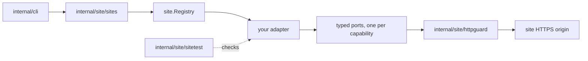

# Adding a site

[Documentation index](README.md) · [Project README](../README.md)

This guide is for contributors adding a built-in site adapter. ptctl ships one
site today, TJUPT, and [TJUPT_ADAPTER.md](TJUPT_ADAPTER.md) documents it as the
reference implementation. The extension points below exist and are enforced by
tests; the [gap list](#gaps-for-api-token-sites) at the end lists what does not
exist yet for sites that authenticate with an API token instead of a cookie.

Read the invariants in [AGENTS.md](../AGENTS.md#invariants) first. They apply
to every adapter, and the conformance suite checks several of them.

## Before you start

- Check that the site's rules allow automated access of the kind you are
  adding. ptctl will not accept ratio cheating, fake upload, challenge bypass,
  or login automation.
- Choose the smallest useful set of capabilities. An adapter that declares only
  `auth.check` is a valid first contribution.
- Never commit a real cookie, token, passkey, private `.torrent`, or captured
  page or API response. Write synthetic fixtures from the documented shape of
  the site, using obviously fake values that contain `CANARY`.

## How a site plugs in

`internal/site/sites` is the only place the CLI learns which sites exist. For
each command, the CLI looks up the adapter by site ID, checks that the
descriptor declares the capability and the auth method, asserts the typed port,
and only then reads the credential from stdin. Adapters never see filesystem
handles, stores, or downloader state.

## Step by step

1. **Create a package** at `internal/site/<id>/`. Export the persisted identity
   as constants, as `internal/site/tjupt/adapter.go` does with `SiteID` and
   `Origin`, and provide a constructor.
2. **Publish a descriptor** from `Descriptor()` that satisfies the
   [descriptor rules](#descriptor-rules).
3. **Implement one typed port per declared capability.** See
   [capabilities and ports](#capabilities-and-ports) for the contract of each
   kind of port.
4. **Register the adapter** by adding its constructor to `All()` in
   `internal/site/sites/sites.go`. Registration panics on a nil adapter, an
   empty ID, or a duplicate ID.
5. **Add conformance samples** for the new site ID to `samples()` in
   `internal/site/sites/sites_test.go`. `TestBuiltinAdaptersConform` fails
   until they exist, then runs `sitetest.TestAdapter` against the adapter.
6. **Test the adapter's own behavior** in its package: parsers against
   synthetic fixtures, page or response recognition including login,
   challenge, maintenance, and unknown responses, stop-reason ordering, and an
   `identity_test.go` that pins every persisted identifier. Inject a fake
   transport the way the TJUPT tests replace `newClient`; nothing may contact
   the real site.
7. **Document it**: add a `docs/<SITE>_ADAPTER.md` modeled on
   [TJUPT_ADAPTER.md](TJUPT_ADAPTER.md), and update
   [FEATURES.md](FEATURES.md) and the [site guide](guide/sites.md).
8. **Run the checks** listed in [AGENTS.md](../AGENTS.md#checks).

## Descriptor rules

`site.ValidateDescriptor` in `internal/site/descriptor.go` enforces these, and
the conformance suite calls it.

| Field | Rule |
|---|---|
| `ID` | Matches `^[a-z][a-z0-9_-]{0,63}$`, which fits every place a site ID is parsed or persisted. It is stored in refs, receipts, route IDs, and sealed records, so it never changes. |
| `Name` | Non-empty display name; non-ASCII is fine. |
| `BaseURL` | An HTTPS origin with at most a single trailing `/`: no user info, query, fragment, or other path. Every origin-pinned port's config must use exactly this origin. |
| `Stability` | Non-empty. New adapters start as `experimental`. |
| `AuthMethods` | At least one, each known, no duplicates. Only `cookie_header` exists today. |
| `Capabilities` | Each known, no duplicates, each backed by its typed port. |

`Descriptor()` must return the same value on every call and must not share its
slices with callers; the suite mutates the returned slices to check this.

## Capabilities and ports

`capabilityPorts` in `internal/site/descriptor.go` is the single mapping from a
capability to its port. Adding a new capability means adding a domain
constant, a port interface, and one entry there.

| Capability | Port | Kind | Used by |
|---|---|---|---|
| `auth.check` | `AuthChecker` | direct | `site status` |
| `account.read` | `AccountReader` | direct | `site account` |
| `torrent.search` | `TorrentSearcher` | direct | `site search` |
| `bonus.catalog.read` | `BonusCatalogReader` | direct | `site bonus-catalog` |
| `torrent.detail` | `TorrentDetailReader` | config and session | `site detail`, `reconcile report --site-ref` |
| `torrent.metafile.read_effectful` | `MetafileFetcher` | config and session | `site metafile fetch` |
| `bonus.offer.review` | `BonusReviewReader` | config and session | `site bonus review` |
| `bonus.exchange.submit_effectful` | `BonusExchangeWriter` | config and session | `site bonus exchange prepare`, `submit` |

### Direct ports

A direct port makes its request when it is called. It must:

- return an error wrapping `context.Canceled` before any request when the
  context is already done;
- reject a credential whose auth method the descriptor does not declare;
- send at most one bounded request through `httpguard`, with no retry;
- fail closed: a login page is unauthenticated, and a maintenance, challenge,
  or unrecognized response is an error, never an empty result.

The CLI replaces every error from a direct port with a fixed
`site <command> failed` message, keeping only typed cancellation and deadline
causes, so adapter error text never reaches the user.

### Config and session ports

The detail, metafile, bonus-review, and bonus-exchange ports separate pure
preflight from the network:

- **Validation** (`ValidateTorrentDetailRef`, `ValidateMetafileRef`,
  `ValidateBonusReviewSelector`, `ValidateBonusExchangeSelector`) is pure. It
  reads no credential and contacts nothing. It must reject a foreign or
  non-canonical site ID and any remote ID or selector that is empty, padded
  with whitespace, or otherwise non-canonical.
- **Config** (`TorrentDetailConfig`, `MetafileFetchConfig`,
  `BonusReviewConfig`, `BonusExchangeConfig`) is credential-free and pins the
  origin and route IDs. The origin must equal the descriptor's origin. If the
  capability is not declared, the config call, validation, and session opening
  must all fail.
- **Opening a session** builds process-local state only. It must reject a
  canceled context and an undeclared auth method without sending anything.
- **Reading** sends at most one request; `MaxRequests` is fixed at one in the
  detail, metafile, and bonus-review limits. Each receipt echoes the pinned
  origin and route ID. An invalid input, a done context, or a closed session
  must fail with zero requests. Their stop reasons are `invalid_reference` or
  `invalid_selector`, `context_done` (wrapping `context.Canceled`), and
  `session_closed`; a closed bonus-exchange session only has to return an
  error.

`BonusExchangeWriter` is stricter still: the session's first request must be
the bounded `ReadFreshBonusReview`, and the review authority it returns can be
consumed by at most one submission. Read the
[bonus exchange design](ARCHITECTURE.md#durable-at-most-once-bonus-exchange)
before implementing it.

## Stop reasons

Receipts carry a stop reason, and the CLI publishes only values it already
knows. Any other value collapses into a generic code:

| Port | CLI allowlist (`internal/cli`) | Fallback |
|---|---|---|
| Torrent detail | `safeTorrentDetailStopReason` in `site_detail.go` | `site.detail_failed` |
| Bonus review | `safeBonusReviewStopReason` in `site_bonus.go` | `site.bonus_review_failed` |
| Metafile fetch | `publicMetafileStopReason` in `site_metafile.go` | `site.fetch_failed` |
| Bonus exchange submit | `safeBonusExchangeSubmitStop` in `site_bonus_exchange.go` | `site.exchange_failed` |

Reuse an existing stop reason whenever one fits. A new one is a public-contract
change: add it to the allowlist and to the CLI tests in the same commit.

## Persisted identity

Site IDs, origins, and route IDs are written into sealed site bindings,
bonus-exchange journals, and private-store records, and are verified when those
records are loaded. Changing one strands every existing record.

- Route IDs use only `[a-z0-9._-]`, are at most 128 bytes, start with
  `<site-id>.`, and end in a version such as `.v1`. The conformance suite
  checks the prefix.
- A new request shape gets a new `.vN` route ID; an existing route ID is never
  reused for different behavior.
- Pin every identifier in an `identity_test.go`, as
  `internal/site/tjupt/identity_test.go` does.

## What not to copy from TJUPT

- **The custom base URL.** `tjupt.New` accepts any base URL and then withdraws
  every origin-pinned capability unless the URL is exactly `DefaultBaseURL`.
  That keeps persisted route IDs from being retargeted, but it doubles the
  surface to test. A new adapter should bind to its production origin and
  inject a fake transport in tests instead.
- **Site-specific heuristics.** TJUPT's login, logout, and page recognition
  rules, its decimal size units, and its `mybonusapps.php` flow are facts about
  TJUPT, not about NexusPHP in general. Re-derive them for each site.
- **Ordering quirks.** TJUPT's sessions check their failure conditions in
  slightly different orders, and those orders are pinned by tests. Match the
  contract above, not one session's incidental ordering.

## Shared code waits for a second site

Do not extract a shared NexusPHP, Unit3D, Gazelle, or general "site kit"
package before a second adapter exists. With one implementation there is no
evidence of which behavior is shared and which is TJUPT-specific, and moving
TJUPT code would put its byte-exact tests at risk. When a second adapter lands,
extract only what both demonstrably share, keep TJUPT's output byte-identical,
and do it in a separate behavior-preserving commit.

## Site families

| Family | Fit today | Main work |
|---|---|---|
| NexusPHP forks, including TJUPT | Cookie sessions match `cookie_header`, and HTML responses match the existing ports. | Page recognition and parsers for that fork, with synthetic fixtures. Forks differ, so do not assume TJUPT's pages. |
| Unit3D | Cookie-session web pages fit. | Using its token-authenticated API instead runs into the gaps below. |
| Gazelle-based trackers | Cookie sessions fit; their JSON responses need a JSON parser rather than HTML recognition. | Where an API key replaces the session cookie, the gaps below apply. |
| M-Team | Does not fit yet. | API key header, separate API host, JSON requests, and a two-step download: all of the gaps below. |

## Gaps for API-token sites

These are the places that assume a cookie, HTML, or a single origin today.
Closing them is design work for the pull request that adds the first API-token
site, where it can be tested against a real API shape. Each item changes a
public contract or a security control, so it needs its own review.

| Gap | Where | What is needed |
|---|---|---|
| Only one auth method exists | `domain.AuthMethod` in `internal/domain/site.go`; `knownAuthMethod` in `internal/site/descriptor.go` | A new method such as `api_key_header`, declared by the adapter. |
| Credential input is cookie-only | `readCredential` in `internal/cli/credentials.go` behind `--cookie-stdin`; `--site-cookie-stdin` and the bundle's `site_cookie` in `internal/cli/reconcile_credentials.go` | Method-aware stdin input that keeps every existing flag and its behavior unchanged. |
| The CLI gates on cookies | Six `SupportsAuth(domain.AuthMethodCookieHeader)` checks in `site.go`, `site_detail.go`, `site_bonus.go`, `site_metafile.go`, `site_bonus_exchange.go`, and `reconcile.go` | Checks keyed to the method the caller supplied. |
| The transport only sends `Cookie` | `httpguard.New(baseURL, cookie, ...)` in `internal/site/httpguard/client.go` | A credential header chosen by auth method, keeping it out of every error and result. |
| Redaction does not know the header | `security.Redact` covers `Authorization` and `Cookie` header lines, but not a line like `x-api-key: VALUE` | A redaction pattern for the new header, with a `CANARY` test. |
| No JSON requests | `httpguard` has `GetOnce` and form-encoded `PostFormOnce`; `Get` sends an HTML `Accept` header | A bounded JSON request. If the API exposes reads as POST requests, the read-path guarantees (one request, nothing written) need a threat-model update. |
| One origin per site | Configs must use the descriptor origin; the suite checks this | Use the API origin as `BaseURL`. A download served from yet another host needs a design decision before that host is contacted. |
| The download is two requests | `MetafileFetchLimits.MaxRequests` must be exactly one, and the receipt has one route ID | A new port or versioned limits and receipts for token-then-download, and an acknowledgement that names both requests. |
| Site-specific CLI text | The `site detail` warning in `internal/cli/site_detail.go` names the TJUPT route | Adapter-supplied or conditional text, changed deliberately because it alters TJUPT's output. |
